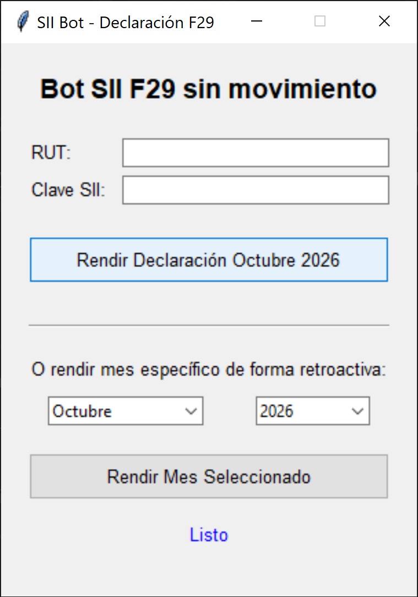

# 🤖 sii_bot

Herramientas para que una empresa chilena no se atrase con el SII: declara el F29 sin movimiento, revisa en modo solo lectura qué tiene pendiente tu empresa y trae una base de conocimiento con las 2.848 preguntas frecuentes del SII.

> Yo mismo, como fundador de una SpA, olvidé declarar el F29 sin movimiento dos veces y tuve que pagar multas innecesarias. Este proyecto partió para que eso no vuelva a pasar y ahora va hacia un "contador personal" que revisa la salud tributaria de la empresa.

| Herramienta | Qué hace | Estado |
| --- | --- | --- |
| **Bot F29** (`main.py` / `SII Bot F29.exe`) | Declara el F29 sin movimiento del mes que corresponde o de un mes atrasado, baja el certificado y lleva un registro. | ✅ Listo |
| **Diagnóstico** (`diagnostico.py`) | Recorre Mi SII y las consultas de estado (anotaciones, F22, F29, término de giro, compras y ventas, notificaciones) y guarda lo que ve, sin declarar, pagar ni enviar nada. | ✅ Listo |
| **Base de conocimiento** (`faq/`) | Las 2.848 preguntas frecuentes públicas del SII en 25 categorías, en JSONL y Markdown, listas para buscar o pasarle a un LLM. | ✅ Listo |
| F29 con movimientos | Llenar el F29 con montos desde un CSV mensual, revisándolos antes de enviar. | 🚧 En desarrollo |
| Avisos de gestiones atrasadas | Detectar meses del F29 sin declarar y avisarte, con el bot corriendo solo cada mes. | 🚧 En desarrollo |



## 🪟 Bot F29 en Windows sin instalar Python

1. Descarga `SII Bot F29.zip` desde [Releases](https://github.com/rodolflying/sii_bot/releases/latest) y descomprímelo (clic derecho → *Extraer todo*). No lo ejecutes desde dentro del zip.
2. Abre la carpeta `SII Bot F29` y ejecuta `SII Bot F29.exe`.
3. Escribe el RUT de la empresa y la clave del SII, y presiona **Rendir Declaración** (el botón indica el período que corresponde declarar). También puedes elegir un mes atrasado de los últimos 5 años.

Se necesita Google Chrome instalado y conexión a internet: la primera vez la app descarga sola el chromedriver que corresponde a tu Chrome. La clave no se guarda en ningún lado.

Si Windows muestra "Windows protegió su PC", presiona *Más información* → *Ejecutar de todas formas* (el ejecutable no está firmado).

⚠️ El bot **envía la declaración de verdad** al SII: úsalo solo si tu empresa no tuvo movimientos en ese mes.

## 🔧 Ejecutar desde el código

Requisitos: Python 3.10 o superior y Google Chrome.

```bash
git clone https://github.com/rodolflying/sii_bot.git
cd sii_bot
pip install -r requirements.txt
python main.py
```

(Opcional) Copia `.env.example` como `.env` y escribe tu RUT y clave para que la ventana los traiga rellenados. El `.env` está en `.gitignore`.

## 🩺 Diagnóstico de solo lectura

```bash
pip install -r requirements-herramientas.txt
python diagnostico.py
```

En Windows también puedes hacer doble clic en `Diagnostico SII.bat`. Abre Chrome con un perfil propio (`.perfil_sii`), entra con el `.env` o espera a que inicies sesión a mano, y recorre las páginas de estado de Mi SII. Por cada página guarda el texto, una captura y los JSON que recibe en `diagnostico/<fecha>/`, con un `indice.md` para revisarlo todo. Solo navega: evita cualquier página de pagar, enviar, declarar, rectificar o modificar.

`.perfil_sii/` y `diagnostico/` contienen tu sesión y los datos de tu empresa: están en `.gitignore`, no los compartas.

## 📚 Base de conocimiento del SII

`faq/faq_sii.jsonl` tiene una pregunta por línea (`id`, `url`, `categoria`, `subtema`, `pregunta`, `respuesta`, `normativa`, fechas de creación y actualización) y `faq/faq_sii.md` las mismas preguntas ordenadas por categoría para leerlas o pasárselas a un LLM. Para bajarlas de nuevo:

```bash
cd faq
python faq_scraper.py bajar
python faq_scraper.py exportar
```

Solo usa páginas públicas de www.sii.cl (una por segundo) y se puede cortar y retomar.

## 🏗️ Compilar el ejecutable

La app se compila con [cx_Freeze](https://cx-freeze.readthedocs.io/) (configuración en `pyproject.toml`). En Windows basta con ejecutar:

```bash
build.bat
```

El script crea un entorno virtual `.venv`, instala las dependencias y cx_Freeze, compila en `build\SII Bot F29\` y deja el zip listo para compartir en `dist\SII Bot F29.zip`.

## 📁 Archivos generados

El bot descarga el certificado PDF si el mes no estaba declarado y lo renombra como `Formulario_29_mes_año.pdf`. También registra cada declaración con su folio en `meses_declarados.csv`. Todo queda en `declaraciones\<RUT>` (una carpeta por empresa) junto a la app. En el ejecutable, el detalle de cada ejecución queda en `sii_bot.log`.

## 📰 Historia

La primera versión (abril 2025) solo declaraba el F29 sin movimiento desde la consola y está explicada en [este artículo de Medium](https://medium.com/@rodolfo.antonio.sep/%EF%B8%8F-automatiza-la-declaraci%C3%B3n-f29-sin-movimientos-en-chile-con-python-y-selenium-d3739db8dfe4). En noviembre 2026 el repositorio se publicó de nuevo con historial limpio, sin certificados ni registros de declaraciones.

## 🤝 Contacto

¿Dudas o sugerencias? Escríbeme por [LinkedIn](https://www.linkedin.com/in/rodolfo-sepulveda-847532135/).
